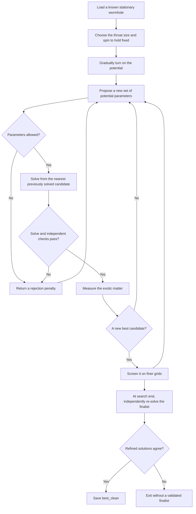

# Stationary spacetime solvers

This subsystem solves stationary, axisymmetric Einstein--scalar systems:
rotating Ellis--Bronnikov wormholes in `spinning_wormhole/`, interacting
phantom/canonical matter in `matter/equations.py`, and regular-centre scalar
rings in `railgun/`. It also owns continuation, parameter search, independent
validation and background export for evolution.

The shared Newton, Jacobian and spectral algorithms live in the standalone package’s `numerics/`.
Install the numerical dependencies with `uv sync --extra stationary` from
`grteclyn-wrapper/`. CPU is the default; selecting a GPU remains explicit.

The former `grteclyn_wrapper.optimisation` and
`grteclyn_wrapper.analysis.spinning_wormhole` imports have moved here. Commands
use `python -m grteclyn_stationary.commands.<name>`. Current callers
use these paths directly. Archived run manifests retain the source revision
and paths that produced their results; resume checks require the new source
hashes to match rather than accepting an old certificate after relocation.

Campaign launchers and configurations are under
`grteclyn-wrapper/scripts/campaigns/<study>/`, with configuration files in
`configs/`. Research notes and article sources remain under `research/`.

## Finding wormholes that need less exotic matter

This package searches for stationary, rotating wormholes that need less exotic
matter to stay open. It starts from a known solution, changes the scalar-field
potential, solves the field equations again, and checks whether the new solution
is both cheaper in exotic matter and numerically trustworthy.

A stationary solution is a possible starting geometry. It does **not** establish
that the wormhole will survive when evolved in time. Stability is a separate
question, and the optimiser currently refuses `--stability`.

The current research results and decisions live in
[the campaign status](../research/optimisation/STATUS.md). This README
explains the code and how its pieces fit together.

## What the search changes

The starting point is a saved wormhole from the published spinning-wormhole
solver. The search adds a potential: a function describing how the scalar field
interacts with itself.

Four numbers describe the potential: its mass scale `m` and three shape
coefficients, `q1`, `q2` and `q3`. By default, the search keeps the wormhole's
angular momentum `J` and equatorial throat radius `R_e` fixed. That makes the
comparison meaningful: less exotic matter for the same size and spin.

Two options change that comparison:

- `--pin area` holds the throat area fixed instead of its equatorial radius,
  allowing the throat's shape to change.
- `--free-J` lets the search vary angular momentum as a fifth parameter.

The legacy `--pin area` uses the smallest **constant-eta surface**. The new
study workflow below fixes the area of a solved, latitude-dependent minimal
surface instead; these definitions need not agree on a deformed throat.

The quantity being minimised is called `X` in the code. It is the magnitude of
the exotic-matter volume integral divided by the throat radius: `X = |VIQ|/R_e`.
With an area pin, the code uses `X_A = |VIQ|/R_A`, where `R_A` is the radius of a
sphere with the same area. These are dimensionless measures; smaller is better
only when the numerical checks also pass.

## Potentials with a negative interior

The default `--potential-domain positive` requires `Q(u)>0` over the whole
field interval. The experimental `endpoint-positive` mode instead requires
`Q(1)>0` and a strictly positive `--m-min`. Both workflows support it.
For the factored potential, the endpoints still obey `V=V'=0`, with
`V''(0)=2m²` and `V''(psi_minus)=2m² Q(1)`. These are local vacuum conditions;
they do not guarantee a regular connecting solution or dynamical stability.

For example, `q=(-4.2,4.2,0)` gives `Q(0)=Q(1)=1` and `Q(0.5)=-0.05`.
Use bounds that contain these coefficients, such as `--q-min -8 --q-max 8`.
The solver already evaluates signed potentials; this option changes the
admissible search family, not the field equations. Polynomial extrema are
checked between collocation nodes too. Candidate metadata records the domain,
and search diagnostics retain the minimum and endpoint value of Q.
The existing independent constraints and final resolution checks still apply.
The rotation equation has no explicit potential source: any change in frame
dragging is mediated by the solved geometry and must be measured.

The reproducible foreground jobs in
`grteclyn-wrapper/scripts/campaigns/optimisation/run_signed_potential.sh` compare a fixed-size,
fixed-spin D90 search and a separate fixed-true-area/free-spin experiment.
The latter needs a massless control at its winning spin before attributing a
reduction to the potential. Neither job runs a time evolution.

## What happens during a search



Each proposal requires a nonlinear solve. Starting from a nearby solved
candidate usually helps Newton's method converge. The initial walk from the
known solution changes the potential gradually; failed steps are bisected a
limited number of times.

For difficult initialization, `--walk-m-steps`, `--walk-max-iter` and
`--walk-max-splits` control the number of mass increments, Newton iterations
per solve and total bisections per leg. Defaults are 3, 12 and 6. Increasing
these budgets changes only the walk to the initial potential; search bounds,
proposal solves and independent validation thresholds remain unchanged.
Failure before `walk-in done` means CMA-ES has not started, not that a dynamical
instability was measured.

Both search engines use the same scoring and checks. Nelder–Mead (`--engine nm`)
moves a simplex through the parameter space. CMA-ES (`--engine cma`) proposes
populations of candidates and adapts their spread. Neither engine changes the
field equations or the acceptance thresholds.

## Why there are several kinds of checks

A small Newton residual only says the equations supplied to Newton have been
solved. The code also measures Einstein constraints that Newton was **not** asked
to satisfy. These independent checks help detect an incorrect or poorly resolved
solution.

A cheap **screen** evaluates the same spectral approximation on finer grids.
It can reject a candidate, but it is not evidence that a fresh solve converges.
**Refinement** actually solves again on the finer grids and compares the results.
The default is to screen new bests and refine the finalist; `--refine-best each`
refines every new best instead.

A failed solve or rejected candidate is recorded as a search outcome. Non-finite
fields, constraint measurements or candidate bills cannot clear validation.

## What the output files mean

- The `.tsv` trace records evaluations, parameters, residuals and verdicts.
- `_eNNNN.npz` files retain accepted search-grid candidates for later inspection.
- `_best_frontier.npz` is a provisional search-grid result.
- `_best_screened.npz` passed finer-grid screening but remains provisional.
- `_best_clean.npz` contains independently refined fields whose checks passed.
  “Clean” describes numerical validation, **not physical stability**.
- The `_resolution/` directory retains the grid checks and their diagnostics.

The search needs a fresh output prefix. It returns exit code `1` when initial
continuation fails, `2` when no validated finalist is available, and `0` when a
validated finalist exists. `--no-save` suppresses the candidate/best NPZ exports;
the trace and resolution-check diagnostics are still produced.

## Fixed true area, bounded tides and massive bosons

The optional `--study-config` workflow keeps the reference's true minimal
throat area, positive-end angular momentum and asymptotic redshift fixed by default.
The graph `xi(mu) = sum c_l T_l(2 mu^2 - 1)` joins the Newton unknowns;
stationarity of its area supplies its equations. An independent, higher-order
surface minimisation checks the area and a positive Hessian, and searches
for additional graph throats. Multiple or unresolved throats fail this study's
single-throat acceptance policy. This finite graph search is not a topology proof.

The objective is `X_full = integral |D PSI|^2 dV / (4 pi R_A)`, the integrated
worst-direction phantom null-energy deficit with local null normalisation
`-n.k = 1`. It includes radial and angular gradients; ordinary matter never
cancels it. `X` and `X_A` retain their legacy, constant-eta definitions in
the output. `X_radial` uses the true throat radius, and `X_angular` records
the extra contribution. Similarity rescales stresses and tides by inverse
length squared while leaving `X_full` unchanged.

The tidal cap uses the maximum absolute eigenvalue across latitude, both
ends and local radial speeds `0, -0.5, +0.5`. It is relative to the same
diagnostic on the matched massless reference. Compactified-domain sampling,
local maximisation, an axis limit and asymptotic shells must converge within
`1e-3`; unresolved peaks fail. It does not bound arbitrary traveller velocities.

The supplied D21 configuration defines three potential-only cases (tidal
factors 1, 2, 4) and 27 matter cases (three factors, three energy budgets and
windings -1, 0, +1). List them without starting a solver:

```bash
grteclyn-wrapper/.venv/bin/python -m grteclyn_stationary.commands.optimize_potential \
  results/spinningwormhole/solutions/fam_a_r1/fam_a_r1_0000.json \
  --study-config grteclyn-wrapper/scripts/campaigns/optimisation/configs/d21_fixed_area.toml
```

To run one case after its resource allocation is agreed, pass `--study-case`
and use the capped runner. For example, a CPU pilot (120 GB address-space cap,
four threads, two-hour timeout; choose a machine with sufficient memory):

```bash
bash grteclyn-wrapper/scripts/ops/capped_job.sh start d21-area-t2 \
  --threads 4 --mem 120 --timeout 7200 -- \
  grteclyn-wrapper/.venv/bin/python -m grteclyn_stationary.commands.optimize_potential \
  results/spinningwormhole/solutions/fam_a_r1/fam_a_r1_0000.json \
  --study-config grteclyn-wrapper/scripts/campaigns/optimisation/configs/d21_fixed_area.toml \
  --study-case potential-t2 --nx 150 --ny 30 --engine cma --maxfev 200 \
  --out runs/optimisation/fixed_area
```

No command here reserves a GPU automatically. The existing `--gpu` and
`--jac-chunk` options remain available for separately authorised GPU jobs.
`--out` is a directory in study mode, with one subdirectory per case. Use
`--resume` to restart from saved candidates; source, implementation and
configuration hashes must match. This is a warm restart, not restoration of
the optimiser's population. The search evaluation limit is cumulative;
reference validation and the finite initial seed matrix are separate costs.

For a potential-only geometry search, add `--free-J --J-min 0 --J-max 7.7
--J-step 0.5` and use `grteclyn-wrapper/scripts/campaigns/optimisation/configs/d21_geometry_free_spin.toml`. The reference's spin initializes the fifth search
parameter; true area and asymptotic redshift remain fixed. `--m-min 0.005`
opens the low-mass regime. The finite spin ceiling is a pilot search bound,
not a theorem about allowed wormholes. The tidal ceiling always refers to
the **initial** massless background, so increasing spin cannot relax the cap.

After three-grid finalist validation, a separate massless continuation and
three-grid check at the winner's spin supplies `matched_reference.npz`.
`outcome.json` separates the joint change from the initial reference from
the matched-spin change. Only the latter can populate
`validated_fractional_improvement`; an unresolved control leaves it null.
The comparison plot normalizes to the initial reference and shows spin on
its second panel. Saved fields retain the full angular throat shape and
scalar gradients. No coordinate-dependent potential or independent prescribed
throat deformation is introduced; shape is determined by the field equations.
A small objective alone does not establish traversability or stability.

The mass-only canonical field uses `chi = sqrt(4 pi) phi` and
`U = m_b^2 |chi|^2`. Its harmonic frequency is solved from the equatorial
mid-column amplitude constraint. This anchor is a coordinate convention,
not necessarily the throat. Winding uses `sin^abs(k)(theta)` for regularity;
the phase is `exp(i omega t + i k phi)`. With positive Noether density the
matter angular momentum is `J_b = -k Q_b`; labels preserve signed winding
rather than assuming that positive k co-rotates with positive total J.

Linear modes and finite-amplitude seeds from Bondi's **positive** mass-only
self-gravitating ODE solver are both attempted. The latter are initial
guesses on a wormhole, not transplanted equilibria. Both-end mass gaps,
resolved decaying tails and the complete coupled equations are required.
Failure of both seed routes is recorded as an unresolved nonzero branch.
Seeds are tried on the massless background and re-pinned potential candidates;
`candidate_seeds` can include a preceding potential study's `best_clean.npz`.
`matter_candidate_seeds` accepts saved nonzero canonical-field candidates.
Their winding, area, J and asymmetry must match the case, and they are
re-solved and rechecked before use. An earlier rejected model can supply a
numerical starting point without inheriting an acceptance verdict.

`commands.continue_boson` offers another initialization route: rescale a
saved mixed-field solution to the reference area, optionally reflect its
azimuthal orientation, then continue total spin and asymmetry separately.
Every step must pass the stationary and bound-state checks. Bisection has
a six-level limit and the whole path an 80-solve budget. Reaching the target
still requires all study gates and three-grid refinement; partial paths are
retained as diagnostics, not D21 candidates.

Ordinary budgets constrain `E_b/R_A`, with `E_b = integral T_nn dV` over
both ends; this positive proper-volume energy is not an ADM mass. The search
also records Noether charge, total matter angular momentum, separate
asymptotic ADM estimates with fit drift, lapse, local phantom NEC, null-ray
integrals and transit times between proper-distance endpoints `+-10 R_A`.
Boson mass and amplitude supplement the four existing potential knobs;
frequency is an eigenvalue, not an independent search knob.

Each case saves `manifest.json`, `evaluations.jsonl`, provisional candidate
NPZs, the separately refined `reference.npz`, refinement records and
`outcome.json`. CMA termination criteria are recorded in `search_stop.json`.
Infeasible candidates receive scores that increase with measured constraint
excess, so a rejected population can move toward feasibility. Every feasible
candidate outranks every infeasible one; this scoring never relaxes the
acceptance gates. Only a successful final check writes `best_clean.npz`.
`comparison.png/pdf` compare tides and ordinary energy with `X_full`;
rebuild them with `python -m grteclyn_stationary.studies.report CASE_DIR`.
NPZ schema 2 preserves canonical fields, frequency and surface coefficients;
legacy five-field files still load. `SPINBG_V1` export refuses canonical
fields because that evolution format cannot represent them.

Final validation perturbs the initial metric and requires Newton corrections
on each finer grid. It repeats every physical constraint, direct off-grid
Ricci-versus-matter and divergence-form scalar checks, and quadrature checks.
Kink potentials are evaluated in factored form to preserve their double
zeros at both asymptotic vacua. Expanding first into monomials causes
cancellation near the nonzero vacuum, amplified by compactification. The
exported polynomial coefficients describe the same potential.
An objective drift above `1e-6` rejects the finalist. Improvements must exceed
the combined numerical uncertainty. All results remain stationary;
self-interactions, multi-throat acceptance and stability are outside this version.

A saved candidate can also be checked separately with `validate_candidate`.
`select_validated_candidate` checks candidates in order of increasing `X`, using
a fresh process for each one, and stops at the first successful handoff.
`handoff` converts saved fields into the background-table format read by the
spinning-wormhole evolution. These tools do not launch an evolution.

## Railgun ring surrounding a throat (replacement prepared November 4)

`grteclyn-wrapper/scripts/campaigns/optimisation/configs/railgun_throat.json` starts with the actual
three-grid accepted weak railgun ring in `results/railgun/studies/ring-validated/`.
Its source files and acceptance record are SHA-256 pinned. This replaces the
older S0-seeded pilot below, which was stopped on request.

The first model has matching toroidal scalar lobes at both mouths, gamma=0,
and zero dragging at **both infinities**. There is no imposed throat spin:
ordinary rotating matter sources W, and the total J+ is measured. Keep the
source's free canonical scalar, mass 1 and integer winding +1 with phase
exp(i omega t+i phi). Frequency is solved; both-end mass gaps and tails must
pass. The phantom potential stays V=0. Fix the true minimal throat area to
16 pi (R_A=2, hence m_b R_A=2); do not optimise the phantom potential in this
first experiment. Symmetric matter-induced throat rotation has a direct
precedent in [Hoffmann et al. (2018)](https://arxiv.org/abs/1803.11044).

`railgun_wormhole.prepare_seed` evaluates the archived f,W,N,B and regular
scalar amplitude at r=sigma sqrt(eta^2+1) on both ends, with an Ellis phantom
kink. It adjusts sigma so the seed's central surface has the target area.
This changes the metric and topology: it is an **unsolved initial guess**,
not an exact coordinate transformation or an accepted superposition. Newton
must re-solve every field. The scalar amplitude border sits at an exterior
compactified coordinate mapped from the source's radius-5 anchor; its value
is evaluated spectrally on every grid. The physical anchor radius may change
as the solved scale changes; no density peak or ring radius is prescribed.

Three fresh perturbed recoveries use 150x24 / 180x30 / 210x36. Existing
independent Einstein/KG, minimum-surface, volume, bound-frequency and decay
gates are retained. Additional checks require reflection symmetry, nonzero
nodeless matter, J_b/2=J+, and an equatorial density peak outside the throat
with throat density below half that peak. These are diffuse rings, without
an exact vacuum gap. Energy E_b/R_A <= 1 and tides <= 4 times the same-area
static Ellis value remain hard limits. The reported ergoregion screen is
explicitly an equatorial sample; no ergoregion is required for acceptance.
Ring energy, charge, J, radius and dragging must also converge at 1e-6.

The phantom-only X_full is compared with the exact same-area static Ellis
reference and a fresh **ring-free, same-J+, same-area, same-gamma, V=0**
wormhole. That control uses up to 12 J steps of at most 0.1, then the same
three-grid independent validation. It may have a different far-end rotating
frame: its spin is carried by the wormhole rather than canonical matter.
A failed or out-of-budget control produces no matched reduction claim.
No equilibrium result certifies dynamical stability.

Preview (no JAX startup, GPU query or output files):

```bash
bash grteclyn-wrapper/scripts/campaigns/optimisation/run_railgun_throat.sh 0 \
  runs/optimisation/railgun_throat_weak
```

Prepared proposal: first node/card 0 only, four CPU threads, 160 GiB address
space, one-hour hard cap including CUDA regressions, at most 18 study solves
and 24 Newton iterations per solve. Platform allocation, no preallocation, float64,
Jacobian chunk 256. No AMR evolution/checkpoints/plotfiles; saved stationary
fields and diagnostics persist on NFS. `--run` needs a fresh go for this
replacement configuration. There are no retries, automatic stronger-ring
steps, one-mouth continuations or resumed optimisation searches.

### Same-angular-momentum control after ring qualification

The November 5 ring passed 210x36 / 224x38 / 240x40. Its separate comparison
is prepared in `grteclyn-wrapper/scripts/campaigns/optimisation/configs/railgun_matched_control.json`;
the entry point is `grteclyn_stationary.ringwormhole.control`. This stage
reads the hash-pinned accepted ring and its same-area static reference without
changing either archive. A fresh ring-free V=0, gamma=0 solution continues
from Ellis to the measured J+=-0.9477747390613108 in ten fixed steps no larger
than 0.1. The true minimal throat area remains 16 pi throughout. Its far-end
rotating frame can differ from the ring solution's nonrotating ends.

Three fresh perturbed recoveries on the ring's grids then use the unchanged
49x21 independent equations, minimum-surface, phantom interval, volume,
angular-momentum and tidal gates. A failed walk or refinement gives no matched
reduction. A successful comparison records a signed fractional reduction;
negative values mean the ring uses more phantom support than the control.
The November 5 control passed all three grids: X_full=1.73450420390979,
versus the ring's 3.106532919972195 at the same area and J. Thus this weak
ring needs 79.1021% more phantom support than the ring-free rotating control;
its 1.116% improvement against static Ellis does not imply an improvement
against the rotating comparison.

```bash
bash grteclyn-wrapper/scripts/campaigns/optimisation/run_railgun_matched_control.sh 0 \
  runs/optimisation/railgun_matched_control_20261105
```

Preview starts no JAX/GPU and writes nothing. Proposed cap: thirteen solves
(ten continuation steps plus three refinements), 24 Newton iterations each,
one hour including CUDA tests, four CPU threads and 160 GiB host address
space, float64/platform allocator, chunk 256, first node/card 0. AMR
checkpoints are proposed OFF; stationary fields/logs stay on NFS. The new
control requires its own run-specific go and checkpoint decision before
`--run`. Stronger-ring and evolution stages are not dispatched by this runner.

## Older S0-seeded wormhole/ring pilot (stopped November 4)

`grteclyn-wrapper/scripts/campaigns/optimisation/configs/wormhole_ring.toml` prepares a bounded pilot
using the existing coupled metric, phantom scalar and canonical winding-field
equations. The canonical amplitude is `sin(theta) zeta(eta,theta)` with phase
`exp(i omega t - i phi)`. Its axial zero permits toroidal matter around the
throat. The density profile is solved, not prescribed; a detached matter-free
gap around the throat is not imposed. Both asymptotically flat ends remain
part of the solve. The frequency is an eigenvalue and must lie in the mass
gap of both ends, including the far end's dragging and redshift.

The first reference is the symmetric rotating member
`results/spinningwormhole/solutions/fam_b/fam_b_0000.json` (gamma=0, J+=0.05).
The old S0 winding field provides a nonzero initial guess. Its old rejection
is retained: `rescale_matter_seeds=true` reconstructs its minimal surface,
rescales to the reference area, reflects the winding, and solves again with
the reference spin. It does not inherit any acceptance verdict. The D21
asymmetry is deliberately not attempted in this pilot: previous rotating
continuations did not qualify a D21 branch.

Three separate cases hold the same true minimal throat area and asymmetry:

- `potential`: phantom-potential search without canonical matter, J+=0.05.
- `ring-fixed`: coupled potential/ring search at the same J+=0.05.
- `ring-spin`: the same coupled search, with J+ varied from 0 to 0.4.

The spin interval is a finite pilot bound, not a stability threshold. Each
case keeps the peak-tide ceiling at four times the original massless
reference's value. Ring cases also require E_b/R_A <= 1. The objective is
the phantom-only `X_full`; positive ordinary energy cannot cancel it.
The parameter ordering is potential m,q1,q2,q3, optional J, then log(m_b R_A)
and log(amplitude). The canonical frequency is never an independent knob.

For a qualified variable-spin finalist, `matched_reference.npz` re-solves
the massless, ring-free wormhole at the finalist's spin. For every qualified
ring finalist, `ring_free_reference.npz` independently re-solves without the
ring at the **same potential parameters m,q, spin, area and asymmetry**, with the original
tidal ceiling. Thus `matched_spin_fractional_change` compares the joint
potential/ring change against V=0; `ring_control_fractional_change` compares
the ring with the recovered control branch. Its
`validated_ring_control_improvement` stays null if the control fails or the
decrease does not exceed numerical uncertainty. The kink's vacuum endpoint
is also solved: identical m,q need not mean an identical function V(psi).
Both endpoint values are retained, and `validated_ring_only_improvement`
additionally requires matching endpoints (or V=0). This control is not a
proof of the best possible ring-free solution across all branches.

Every finalist/control uses the unchanged unused Einstein equations,
independent off-grid Ricci/Klein–Gordon checks, both-end decay, volume
quadrature, minimum-surface and tidal checks, followed by fresh
150x30 / 180x36 / 210x42 solves. Stationary validation does not certify
dynamical stability. No evolution export or launch is part of this pilot.

Preview one job without accessing a GPU or writing output:

```bash
bash grteclyn-wrapper/scripts/campaigns/optimisation/run_wormhole_ring.sh ring-spin 0 \
  runs/optimisation/wormhole_ring_pilot
```

After a separate go for that case/card, adding `--run` checks the card and
dispatches one capped job: four threads, 160 GiB address space, **4 h hard
limit**, 48 CMA proposals, six continuation bisections per proposal, and
24 Newton iterations per solve. Reference, seed and final-control solves
also consume that same time limit. This is a resource ceiling, not a measured
ETA. There is no automatic queue, evolution, plotfile or AMR checkpoint.
Use a fresh output root for each attempt; capped-job logs retain failures.
The dispatcher explicitly selects the CUDA `platform` allocator without
preallocation: creating the async pool failed under the 160 GiB address-space
cap before any solve, while a capped platform-allocator matrix test passed.

## Where to look in the code

- **`commands/`** parses command-line arguments and dispatches work. Start here
  to find an option or see how a tool is invoked.
- **`workflows/`** contains the solves, scans, extension trials and candidate
  validation/selection procedures behind those commands.
- **`search/`** contains the potential optimiser. `driver.py` coordinates a
  search; `engines.py` runs the two optimisation engines; `objective.py` scores
  proposals using the positivity and penalty rules in `scoring.py`; `evaluation.py` solves and checks them; `continuation.py` manages
  the walk between solutions; `artifacts.py` writes traces and candidate files.
  `state.py` holds the shared constants and per-search context.
- **`matter/equations.py`** defines the physical equations and the conditions
  that hold size and spin fixed. **`matter/potentials.py`** defines the potential families.
- **`geometry/exoticity.py`** measures exotic matter, throat geometry and tidal effects.
  **`search/parameters.py`** handles parameter vectors and the choice of size measure.
- **`workflows/common.py`** supplies shared operations for stationary extension trials.
  **`validation/resolution.py`** screens and independently refines saved candidates.
- **`numerics/`** contains Newton iteration, Jacobians, spectral grids,
  coordinate maps and device configuration. It has no physics dependencies.
- **`checks/`** contains independent numerical and physical cross-checks.
  **`derivations/`** contains symbolic derivations and transcription checks.
- **`validation/radial.py`** is diagnostic radial-stability work under repair.
  **`exports/wormhole.py`** writes evolution background tables.
- **`src/grteclyn_wrapper/campaigns/stationary/pipeline.toml`** lists the configured campaign stages and their resource caps.

Plots stay in [the optimisation visualisation package](src/grteclyn_wrapper/visualisation/optimisation).
Tests stay in [tests/stationary](tests/stationary).
The [spinning-wormhole model](packages/stationary/src/grteclyn_stationary/spinning_wormhole) supplies saved-solution readers
and the massless reference solver. It depends only on shared numerics and its
own physics. Analysis, campaign tools and plots consume stationary models;
the stationary models do not import the analysis or episode CLI packages.

## Running the tools

From the repository root, use the wrapper's Python environment:

```bash
PY=grteclyn-wrapper/.venv/bin/python

# Read available options; these commands start no solves.
$PY -m grteclyn_stationary.commands.optimize_potential --help
$PY -m grteclyn_stationary.commands.validate_candidate --help
$PY -m grteclyn_stationary.checks.check_matter_pins --help
$PY -m grteclyn_stationary.derivations.derive_matter_equations --help

# Inspect the configured pipeline and a proposed CPU command.
$PY -m grteclyn_wrapper.campaigns.stationary.pipeline list
$PY -m grteclyn_wrapper.campaigns.stationary.pipeline run first-v-0003-150 --dry-run
```

Actual campaign jobs go through `scripts/ops/capped_job.sh`; the pipeline uses it
automatically. It applies thread, memory and time limits. `--gpu N` selects a
card; the pipeline checks that card before launching. `--force` can override a
busy-card check, but cannot override a failed or missing device query.

JAX and SymPy come from the wrapper's `stationary` extra. GPU execution needs
a suitable CUDA JAX installation; the CPU tests do not require a GPU. Imports
and `--help` do not initialise JAX. An installed wrapper can find campaign files
through `GRTECLYN_ROOT`, set to the checkout; the stage configuration itself is
included in the wrapper package.

```bash
# Numerical and workflow regression tests, on CPU.
OPENBLAS_NUM_THREADS=1 OMP_NUM_THREADS=1 JAX_PLATFORMS=cpu \
  $PY -m pytest -q grteclyn-wrapper/tests/stationary \
                 grteclyn-wrapper/tests/stationary/spinning_wormhole
```

The workflow tests replace expensive solves and process launches with controlled
fixtures. The numerical tests also run real CPU solves and check the independent
constraints. Packaging tests check the commands and configuration from an
installed wheel, outside the source checkout.

## Regular-centre scalar rings

The separate `railgun/` study reuses the generic Newton core while replacing
the wormhole domain and boundary rows. It supports independent canonical
winding fields and parity, independent Cartesian/intrinsic KG checks, a
bounded two-field branch initializer, and certified regular-core MPD transport.
Current acceptance and launch permissions live in
[the ring status](../research/railgun/STATUS.md); equations and commands
are documented beside it. No rotating-ring or stability result follows from
the validated spherical baseline.
