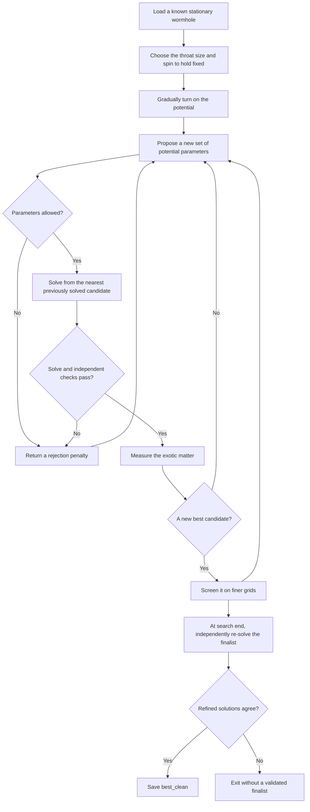

# Finding wormholes that need less exotic matter

This package searches for stationary, rotating wormholes that need less exotic
matter to stay open. It starts from a known solution, changes the scalar-field
potential, solves the field equations again, and checks whether the new solution
is both cheaper in exotic matter and numerically trustworthy.

A stationary solution is a possible starting geometry. It does **not** establish
that the wormhole will survive when evolved in time. Stability is a separate
question, and the optimiser currently refuses `--stability`.

The current research results and decisions live in
[the campaign status](../../../../research/optimisation/STATUS.md). This README
explains the code and how its pieces fit together.

## What the search changes

The starting point is a saved wormhole from the published spinning-wormhole
solver. The search adds a potential: a function describing how the scalar field
interacts with itself.

Four numbers describe the potential: its mass scale `m` and three shape
coefficients, `q1`, `q2` and `q3`. By default, the search keeps the wormhole's
angular momentum `J` and equatorial throat radius `R_e` fixed. That makes the
comparison meaningful: less exotic matter for the same size and spin.

Two options change that comparison:

- `--pin area` holds the throat area fixed instead of its equatorial radius,
  allowing the throat's shape to change.
- `--free-J` lets the search vary angular momentum as a fifth parameter.

The legacy `--pin area` uses the smallest **constant-eta surface**. The new
study workflow below fixes the area of a solved, latitude-dependent minimal
surface instead; these definitions need not agree on a deformed throat.

The quantity being minimised is called `X` in the code. It is the magnitude of
the exotic-matter volume integral divided by the throat radius: `X = |VIQ|/R_e`.
With an area pin, the code uses `X_A = |VIQ|/R_A`, where `R_A` is the radius of a
sphere with the same area. These are dimensionless measures; smaller is better
only when the numerical checks also pass.

## What happens during a search



Each proposal requires a nonlinear solve. Starting from a nearby solved
candidate usually helps Newton's method converge. The initial walk from the
known solution changes the potential gradually; failed steps are bisected a
limited number of times.

For difficult initialization, `--walk-m-steps`, `--walk-max-iter` and
`--walk-max-splits` control the number of mass increments, Newton iterations
per solve and total bisections per leg. Defaults are 3, 12 and 6. Increasing
these budgets changes only the walk to the initial potential; search bounds,
proposal solves and independent validation thresholds remain unchanged.
Failure before `walk-in done` means CMA-ES has not started, not that a dynamical
instability was measured.

Both search engines use the same scoring and checks. Nelder–Mead (`--engine nm`)
moves a simplex through the parameter space. CMA-ES (`--engine cma`) proposes
populations of candidates and adapts their spread. Neither engine changes the
field equations or the acceptance thresholds.

## Why there are several kinds of checks

A small Newton residual only says the equations supplied to Newton have been
solved. The code also measures Einstein constraints that Newton was **not** asked
to satisfy. These independent checks help detect an incorrect or poorly resolved
solution.

A cheap **screen** evaluates the same spectral approximation on finer grids.
It can reject a candidate, but it is not evidence that a fresh solve converges.
**Refinement** actually solves again on the finer grids and compares the results.
The default is to screen new bests and refine the finalist; `--refine-best each`
refines every new best instead.

A failed solve or rejected candidate is recorded as a search outcome. Non-finite
fields, constraint measurements or candidate bills cannot clear validation.

## What the output files mean

- The `.tsv` trace records evaluations, parameters, residuals and verdicts.
- `_eNNNN.npz` files retain accepted search-grid candidates for later inspection.
- `_best_frontier.npz` is a provisional search-grid result.
- `_best_screened.npz` passed finer-grid screening but remains provisional.
- `_best_clean.npz` contains independently refined fields whose checks passed.
  “Clean” describes numerical validation, **not physical stability**.
- The `_resolution/` directory retains the grid checks and their diagnostics.

The search needs a fresh output prefix. It returns exit code `1` when initial
continuation fails, `2` when no validated finalist is available, and `0` when a
validated finalist exists. `--no-save` suppresses the candidate/best NPZ exports;
the trace and resolution-check diagnostics are still produced.

## Fixed true area, bounded tides and massive bosons

The optional `--study-config` workflow keeps the reference's true minimal
throat area, positive-end angular momentum and asymptotic redshift fixed.
The graph `xi(mu) = sum c_l T_l(2 mu^2 - 1)` joins the Newton unknowns;
stationarity of its area supplies its equations. An independent, higher-order
surface minimisation checks the area and a positive Hessian, and searches
for additional graph throats. Multiple or unresolved throats fail this study's
single-throat acceptance policy. This finite graph search is not a topology proof.

The objective is `X_full = integral |D PSI|^2 dV / (4 pi R_A)`, the integrated
worst-direction phantom null-energy deficit with local null normalisation
`-n.k = 1`. It includes radial and angular gradients; ordinary matter never
cancels it. `X` and `X_A` retain their legacy, constant-eta definitions in
the output. `X_radial` uses the true throat radius, and `X_angular` records
the extra contribution. Similarity rescales stresses and tides by inverse
length squared while leaving `X_full` unchanged.

The tidal cap uses the maximum absolute eigenvalue across latitude, both
ends and local radial speeds `0, -0.5, +0.5`. It is relative to the same
diagnostic on the matched massless reference. Compactified-domain sampling,
local maximisation, an axis limit and asymptotic shells must converge within
`1e-3`; unresolved peaks fail. It does not bound arbitrary traveller velocities.

The supplied D21 configuration defines three potential-only cases (tidal
factors 1, 2, 4) and 27 matter cases (three factors, three energy budgets and
windings -1, 0, +1). List them without starting a solver:

```bash
grteclyn-wrapper/.venv/bin/python -m grteclyn_wrapper.optimisation.commands.optimize_potential \
  results/spinningwormhole/solutions/fam_a_r1/fam_a_r1_0000.json \
  --study-config research/optimisation/studies/d21_fixed_area.toml
```

To run one case after its resource allocation is agreed, pass `--study-case`
and use the capped runner. For example, a CPU pilot (120 GB address-space cap,
four threads, two-hour timeout; choose a machine with sufficient memory):

```bash
bash grteclyn-wrapper/scripts/ops/capped_job.sh start d21-area-t2 \
  --threads 4 --mem 120 --timeout 7200 -- \
  grteclyn-wrapper/.venv/bin/python -m grteclyn_wrapper.optimisation.commands.optimize_potential \
  results/spinningwormhole/solutions/fam_a_r1/fam_a_r1_0000.json \
  --study-config research/optimisation/studies/d21_fixed_area.toml \
  --study-case potential-t2 --nx 150 --ny 30 --engine cma --maxfev 200 \
  --out runs/optimisation/fixed_area
```

No command here reserves a GPU automatically. The existing `--gpu` and
`--jac-chunk` options remain available for separately authorised GPU jobs.
`--out` is a directory in study mode, with one subdirectory per case. Use
`--resume` to restart from saved candidates; source, implementation and
configuration hashes must match. This is a warm restart, not restoration of
the optimiser's population. The search evaluation limit is cumulative;
reference validation and the finite initial seed matrix are separate costs.

The mass-only canonical field uses `chi = sqrt(4 pi) phi` and
`U = m_b^2 |chi|^2`. Its harmonic frequency is solved from the equatorial
mid-column amplitude constraint. This anchor is a coordinate convention,
not necessarily the throat. Winding uses `sin^abs(k)(theta)` for regularity;
the phase is `exp(i omega t + i k phi)`. With positive Noether density the
matter angular momentum is `J_b = -k Q_b`; labels preserve signed winding
rather than assuming that positive k co-rotates with positive total J.

Linear modes and finite-amplitude seeds from Bondi's **positive** mass-only
self-gravitating ODE solver are both attempted. The latter are initial
guesses on a wormhole, not transplanted equilibria. Both-end mass gaps,
resolved decaying tails and the complete coupled equations are required.
Failure of both seed routes is recorded as an unresolved nonzero branch.
Seeds are tried on the massless background and re-pinned potential candidates;
`candidate_seeds` can include a preceding potential study's `best_clean.npz`.
`matter_candidate_seeds` accepts saved nonzero canonical-field candidates.
Their winding, area, J and asymmetry must match the case, and they are
re-solved and rechecked before use. An earlier rejected model can supply a
numerical starting point without inheriting an acceptance verdict.

Ordinary budgets constrain `E_b/R_A`, with `E_b = integral T_nn dV` over
both ends; this positive proper-volume energy is not an ADM mass. The search
also records Noether charge, total matter angular momentum, separate
asymptotic ADM estimates with fit drift, lapse, local phantom NEC, null-ray
integrals and transit times between proper-distance endpoints `+-10 R_A`.
Boson mass and amplitude supplement the four existing potential knobs;
frequency is an eigenvalue, not an independent search knob.

Each case saves `manifest.json`, `evaluations.jsonl`, provisional candidate
NPZs, the separately refined `reference.npz`, refinement records and
`outcome.json`. CMA termination criteria are recorded in `search_stop.json`.
Infeasible candidates receive scores that increase with measured constraint
excess, so a rejected population can move toward feasibility. Every feasible
candidate outranks every infeasible one; this scoring never relaxes the
acceptance gates. Only a successful final check writes `best_clean.npz`.
`comparison.png/pdf` compare tides and ordinary energy with `X_full`;
rebuild them with `python -m grteclyn_wrapper.optimisation.study_report CASE_DIR`.
NPZ schema 2 preserves canonical fields, frequency and surface coefficients;
legacy five-field files still load. `SPINBG_V1` export refuses canonical
fields because that evolution format cannot represent them.

Final validation perturbs the initial metric and requires Newton corrections
on each finer grid. It repeats every physical constraint, direct off-grid
Ricci-versus-matter and divergence-form scalar checks, and quadrature checks.
Kink potentials are evaluated in factored form to preserve their double
zeros at both asymptotic vacua. Expanding first into monomials causes
cancellation near the nonzero vacuum, amplified by compactification. The
exported polynomial coefficients describe the same potential.
An objective drift above `1e-6` rejects the finalist. Improvements must exceed
the combined numerical uncertainty. All results remain stationary;
self-interactions, multi-throat acceptance and stability are outside this version.

A saved candidate can also be checked separately with `validate_candidate`.
`select_validated_candidate` checks candidates in order of increasing `X`, using
a fresh process for each one, and stops at the first successful handoff.
`handoff` converts saved fields into the background-table format read by the
spinning-wormhole evolution. These tools do not launch an evolution.

## Where to look in the code

- **`commands/`** parses command-line arguments and dispatches work. Start here
  to find an option or see how a tool is invoked.
- **`workflows/`** contains the solves, scans, extension trials and candidate
  validation/selection procedures behind those commands.
- **`search/`** contains the potential optimiser. `driver.py` coordinates a
  search; `engines.py` runs the two optimisation engines; `objective.py` scores
  proposals using the positivity and penalty rules in `scoring.py`; `evaluation.py` solves and checks them; `continuation.py` manages
  the walk between solutions; `artifacts.py` writes traces and candidate files.
  `state.py` holds the shared constants and per-search context.
- **`matter_equations.py`** defines the physical equations and the conditions
  that hold size and spin fixed. **`potentials.py`** defines the potential families.
- **`exoticity.py`** measures exotic matter, throat geometry and tidal effects.
  **`knobs.py`** handles parameter vectors and the choice of size measure.
- **`exploration.py`** supplies shared operations for stationary extension trials.
  **`resolution.py`** screens and independently refines saved candidates.
- **`solver/`** contains Newton iteration, Jacobians and device configuration.
  It has no dependency on the wormhole physics code.
- **`checks/`** contains independent numerical and physical cross-checks.
  **`derivations/`** contains symbolic derivations and transcription checks.
- **`stability_radial.py`** is diagnostic radial-stability work under repair.
  **`handoff.py`** writes evolution background tables.
- **`pipeline.toml`** lists the configured campaign stages and their resource caps.

Plots stay in [the optimisation visualisation package](../visualisation/optimisation/).
Tests stay in [tests/optimisation](../../../tests/optimisation/).
The published [spinning-wormhole package](../analysis/spinning_wormhole/) supplies
spectral grids, saved-solution readers and the massless reference solver. The
dependency goes from optimisation to that published package, never back from it.
Only optimisation and its own plotting package may import optimisation code.

## Running the tools

From the repository root, use the wrapper's Python environment:

```bash
PY=grteclyn-wrapper/.venv/bin/python

# Read available options; these commands start no solves.
$PY -m grteclyn_wrapper.optimisation.commands.optimize_potential --help
$PY -m grteclyn_wrapper.optimisation.commands.validate_candidate --help
$PY -m grteclyn_wrapper.optimisation.checks.check_matter_pins --help
$PY -m grteclyn_wrapper.optimisation.derivations.derive_matter_equations --help

# Inspect the configured pipeline and a proposed CPU command.
$PY -m grteclyn_wrapper.optimisation.commands.pipeline list
$PY -m grteclyn_wrapper.optimisation.commands.pipeline run first-v-0003-150 --dry-run
```

Actual campaign jobs go through `scripts/ops/capped_job.sh`; the pipeline uses it
automatically. It applies thread, memory and time limits. `--gpu N` selects a
card; the pipeline checks that card before launching. `--force` can override a
busy-card check, but cannot override a failed or missing device query.

JAX and SymPy come from the wrapper's `spinning-solver` extra. GPU execution needs
a suitable CUDA JAX installation; the CPU tests do not require a GPU. Imports
and `--help` do not initialise JAX. An installed wrapper can find campaign files
through `GRTECLYN_ROOT`, set to the checkout; the stage configuration itself is
included in the Python package.

```bash
# Numerical and workflow regression tests, on CPU.
OPENBLAS_NUM_THREADS=1 OMP_NUM_THREADS=1 JAX_PLATFORMS=cpu \
  $PY -m pytest -q grteclyn-wrapper/tests/optimisation \
                 grteclyn-wrapper/tests/spinning_wormhole
```

The workflow tests replace expensive solves and process launches with controlled
fixtures. The numerical tests also run real CPU solves and check the independent
constraints. Packaging tests check the commands and configuration from an
installed wheel, outside the source checkout.
