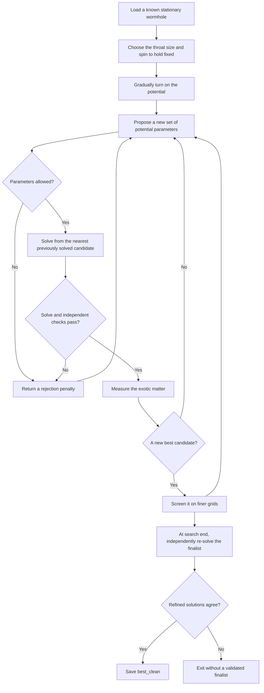

# Finding wormholes that need less exotic matter

This package searches for stationary, rotating wormholes that need less exotic
matter to stay open. It starts from a known solution, changes the scalar-field
potential, solves the field equations again, and checks whether the new solution
is both cheaper in exotic matter and numerically trustworthy.

A stationary solution is a possible starting geometry. It does **not** establish
that the wormhole will survive when evolved in time. Stability is a separate
question, and the optimiser currently refuses `--stability`.

The current research results and decisions live in
[the campaign status](../../../../research/optimisation/STATUS.md). This README
explains the code and how its pieces fit together.

## What the search changes

The starting point is a saved wormhole from the published spinning-wormhole
solver. The search adds a potential: a function describing how the scalar field
interacts with itself.

Four numbers describe the potential: its mass scale `m` and three shape
coefficients, `q1`, `q2` and `q3`. By default, the search keeps the wormhole's
angular momentum `J` and equatorial throat radius `R_e` fixed. That makes the
comparison meaningful: less exotic matter for the same size and spin.

Two options change that comparison:

- `--pin area` holds the throat area fixed instead of its equatorial radius,
  allowing the throat's shape to change.
- `--free-J` lets the search vary angular momentum as a fifth parameter.

The quantity being minimised is called `X` in the code. It is the magnitude of
the exotic-matter volume integral divided by the throat radius: `X = |VIQ|/R_e`.
With an area pin, the code uses `X_A = |VIQ|/R_A`, where `R_A` is the radius of a
sphere with the same area. These are dimensionless measures; smaller is better
only when the numerical checks also pass.

## What happens during a search



Each proposal requires a nonlinear solve. Starting from a nearby solved
candidate usually helps Newton's method converge. The initial walk from the
known solution changes the potential gradually; failed steps are bisected a
limited number of times.

Both search engines use the same scoring and checks. Nelder–Mead (`--engine nm`)
moves a simplex through the parameter space. CMA-ES (`--engine cma`) proposes
populations of candidates and adapts their spread. Neither engine changes the
field equations or the acceptance thresholds.

## Why there are several kinds of checks

A small Newton residual only says the equations supplied to Newton have been
solved. The code also measures Einstein constraints that Newton was **not** asked
to satisfy. These independent checks help detect an incorrect or poorly resolved
solution.

A cheap **screen** evaluates the same spectral approximation on finer grids.
It can reject a candidate, but it is not evidence that a fresh solve converges.
**Refinement** actually solves again on the finer grids and compares the results.
The default is to screen new bests and refine the finalist; `--refine-best each`
refines every new best instead.

A failed solve or rejected candidate is recorded as a search outcome. Non-finite
fields, constraint measurements or candidate bills cannot clear validation.

## What the output files mean

- The `.tsv` trace records evaluations, parameters, residuals and verdicts.
- `_eNNNN.npz` files retain accepted search-grid candidates for later inspection.
- `_best_frontier.npz` is a provisional search-grid result.
- `_best_screened.npz` passed finer-grid screening but remains provisional.
- `_best_clean.npz` contains independently refined fields whose checks passed.
  “Clean” describes numerical validation, **not physical stability**.
- The `_resolution/` directory retains the grid checks and their diagnostics.

The search needs a fresh output prefix. It returns exit code `1` when initial
continuation fails, `2` when no validated finalist is available, and `0` when a
validated finalist exists. `--no-save` suppresses the candidate/best NPZ exports;
the trace and resolution-check diagnostics are still produced.

A saved candidate can also be checked separately with `validate_candidate`.
`select_validated_candidate` checks candidates in order of increasing `X`, using
a fresh process for each one, and stops at the first successful handoff.
`handoff` converts saved fields into the background-table format read by the
spinning-wormhole evolution. These tools do not launch an evolution.

## Where to look in the code

- **`commands/`** parses command-line arguments and dispatches work. Start here
  to find an option or see how a tool is invoked.
- **`workflows/`** contains the solves, scans, extension trials and candidate
  validation/selection procedures behind those commands.
- **`search/`** contains the potential optimiser. `driver.py` coordinates a
  search; `engines.py` runs the two optimisation engines; `objective.py` scores
  proposals using the positivity and penalty rules in `scoring.py`; `evaluation.py` solves and checks them; `continuation.py` manages
  the walk between solutions; `artifacts.py` writes traces and candidate files.
  `state.py` holds the shared constants and per-search context.
- **`matter_equations.py`** defines the physical equations and the conditions
  that hold size and spin fixed. **`potentials.py`** defines the potential families.
- **`exoticity.py`** measures exotic matter, throat geometry and tidal effects.
  **`knobs.py`** handles parameter vectors and the choice of size measure.
- **`exploration.py`** supplies shared operations for stationary extension trials.
  **`resolution.py`** screens and independently refines saved candidates.
- **`solver/`** contains Newton iteration, Jacobians and device configuration.
  It has no dependency on the wormhole physics code.
- **`checks/`** contains independent numerical and physical cross-checks.
  **`derivations/`** contains symbolic derivations and transcription checks.
- **`stability_radial.py`** is diagnostic radial-stability work under repair.
  **`handoff.py`** writes evolution background tables.
- **`pipeline.toml`** lists the configured campaign stages and their resource caps.

Plots stay in [the optimisation visualisation package](../visualisation/optimisation/).
Tests stay in [tests/optimisation](../../../tests/optimisation/).
The published [spinning-wormhole package](../analysis/spinning_wormhole/) supplies
spectral grids, saved-solution readers and the massless reference solver. The
dependency goes from optimisation to that published package, never back from it.
Only optimisation and its own plotting package may import optimisation code.

## Running the tools

From the repository root, use the wrapper's Python environment:

```bash
PY=grteclyn-wrapper/.venv/bin/python

# Read available options; these commands start no solves.
$PY -m grteclyn_wrapper.optimisation.commands.optimize_potential --help
$PY -m grteclyn_wrapper.optimisation.commands.validate_candidate --help
$PY -m grteclyn_wrapper.optimisation.checks.check_matter_pins --help
$PY -m grteclyn_wrapper.optimisation.derivations.derive_matter_equations --help

# Inspect the configured pipeline and a proposed CPU command.
$PY -m grteclyn_wrapper.optimisation.commands.pipeline list
$PY -m grteclyn_wrapper.optimisation.commands.pipeline run first-v-0003-150 --dry-run
```

Actual campaign jobs go through `scripts/ops/capped_job.sh`; the pipeline uses it
automatically. It applies thread, memory and time limits. `--gpu N` selects a
card; the pipeline checks that card before launching. `--force` can override a
busy-card check, but cannot override a failed or missing device query.

JAX and SymPy come from the wrapper's `spinning-solver` extra. GPU execution needs
a suitable CUDA JAX installation; the CPU tests do not require a GPU. Imports
and `--help` do not initialise JAX. An installed wrapper can find campaign files
through `GRTECLYN_ROOT`, set to the checkout; the stage configuration itself is
included in the Python package.

```bash
# Numerical and workflow regression tests, on CPU.
OPENBLAS_NUM_THREADS=1 OMP_NUM_THREADS=1 JAX_PLATFORMS=cpu \
  $PY -m pytest -q grteclyn-wrapper/tests/optimisation \
                 grteclyn-wrapper/tests/spinning_wormhole
```

The workflow tests replace expensive solves and process launches with controlled
fixtures. The numerical tests also run real CPU solves and check the independent
constraints. Packaging tests check the commands and configuration from an
installed wheel, outside the source checkout.
